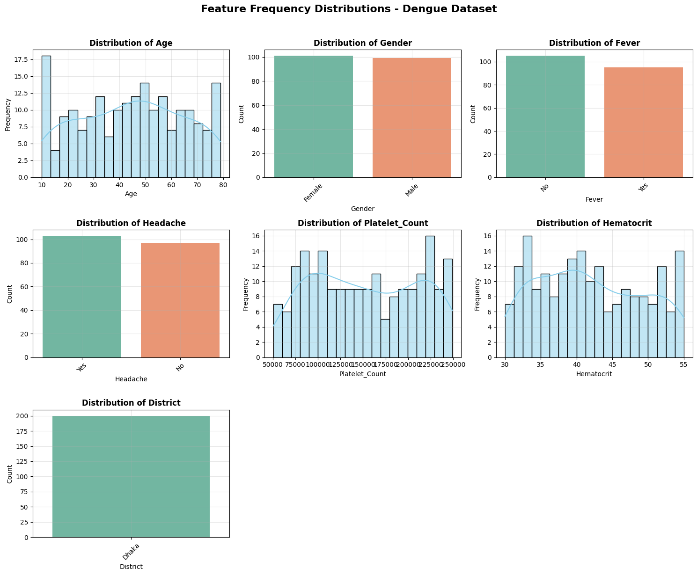
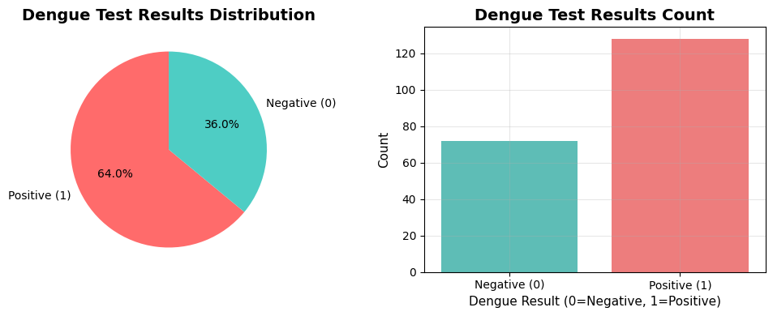
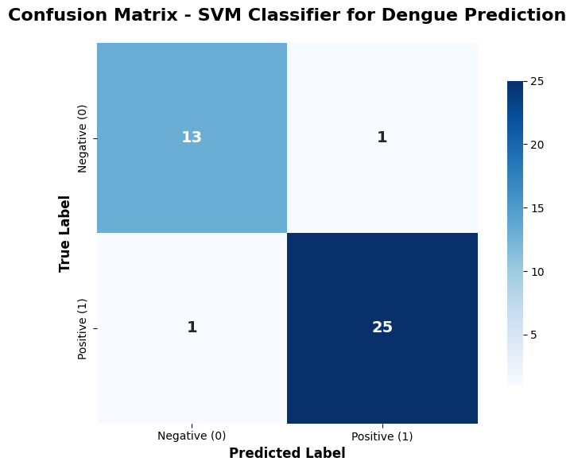
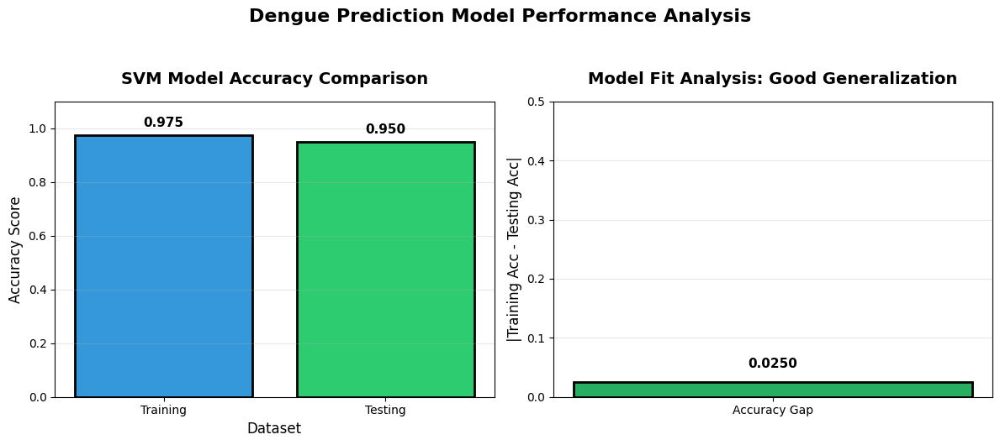
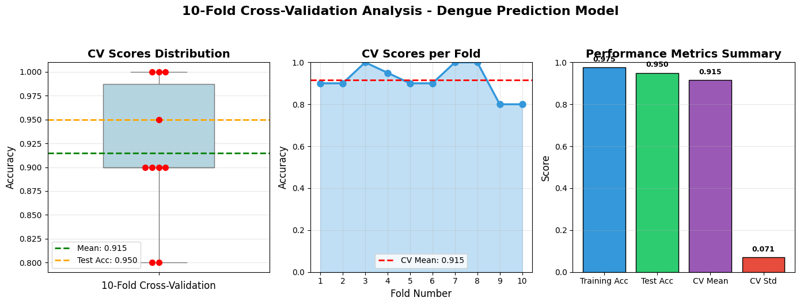

# Dengue Fever Prediction System

## Project Overview

This project presents a machine learning-based **Dengue Fever Prediction System** built using the Python programming language. The system utilizes a **Support Vector Machine (SVM)** classifier with a Radial Basis Function (RBF) kernel to predict whether a patient is likely to have dengue fever based on clinical and demographic features.

The goal of this project is to provide an accurate and reliable predictive tool that can assist in the early diagnosis of dengue fever, potentially improving patient outcomes through timely medical intervention.

---

## Dataset Description

The dataset used in this project contains clinical records of patients, including demographic information and laboratory test results. It consists of **200 samples** with **8 columns**.

| Column Name | Description | Data Type |
|-------------|-------------|-----------|
| `Age` | Patient's age (in years) | Integer |
| `Gender` | Patient's gender (Male/Female) | Categorical |
| `Fever` | Presence of fever (Yes/No) | Categorical |
| `Headache` | Presence of headache (Yes/No) | Categorical |
| `Platelet_Count` | Platelet count (per microliter) | Integer |
| `Hematocrit` | Hematocrit percentage | Float |
| `District` | District of residence | Categorical |
| `Dengue_Result` | Target variable (0 = Negative, 1 = Positive) | Integer |

**Dataset Statistics:**
- Total samples: 200
- Positive cases (Dengue): 128 (64.0%)
- Negative cases: 72 (36.0%)
- No missing values
- No duplicate rows

---

## Visualizations

### 1. Feature Frequency Distributions

The distributions of all features were analyzed to understand the underlying data patterns.



### 2. Dengue Test Results Distribution

The target variable distribution shows the class balance between positive and negative dengue cases.



---

## Methodology

### 1. Data Preprocessing

- **Label Encoding:** Categorical features (`Gender`, `Fever`, `Headache`, `District`) were converted into numerical values using `LabelEncoder`.
  - Gender: Female = 0, Male = 1
  - Fever: No = 0, Yes = 1
  - Headache: No = 0, Yes = 1
  - District: Dhaka = 0
- **Feature Scaling:** All features were standardized using `StandardScaler` to bring them to a common scale.

### 2. Train-Test Split

The dataset was split into training and testing sets using an **80/20 split** with stratification to maintain class balance.

- Training set: 160 samples (80%)
- Testing set: 40 samples (20%)

### 3. Model Training

A **Support Vector Machine (SVM)** classifier was trained with the following hyperparameters:

- Kernel: RBF (Radial Basis Function)
- Regularization parameter (C): 1.0
- Gamma: 'scale'
- Number of Support Vectors: 73

### 4. Model Evaluation

The model was evaluated using multiple performance metrics including accuracy, precision, recall, specificity, and F1-score. Additionally, **10-Fold Cross-Validation** was performed to assess the model's generalization capability.

---

## Model Performance

### Confusion Matrix

The confusion matrix summarizes the classification results on the test set.



| | Predicted Negative | Predicted Positive |
|---|---|---|
| **Actual Negative** | 13 (TN) | 1 (FP) |
| **Actual Positive** | 1 (FN) | 25 (TP) |

### Performance Metrics

| Metric | Score | Percentage |
|--------|-------|------------|
| Accuracy | 0.9500 | 95.00% |
| Precision | 0.9615 | 96.15% |
| Recall | 0.9615 | 96.15% |
| Specificity | 0.9286 | 92.86% |
| F1-Score | 0.9615 | 96.15% |

### Accuracy Comparison and Model Fit Analysis

The model shows good generalization with a small gap between training and testing accuracy.



- **Training Accuracy:** 97.50%
- **Testing Accuracy:** 95.00%
- **Accuracy Gap:** 2.50% (Good Generalization)

### 10-Fold Cross-Validation

Cross-validation was performed to ensure the model's robustness and reliability.



| Metric | Score |
|--------|-------|
| CV Mean Accuracy | 91.50% |
| CV Standard Deviation | 7.09% |
| CV Accuracy Range | [80.00%, 100.00%] |

---

## Key Findings

1.  **High Accuracy:** The SVM model achieved a test accuracy of **95.00%**, demonstrating excellent predictive capability.
2.  **Good Generalization:** The small difference between training (97.50%) and testing (95.00%) accuracy indicates that the model is not overfitting.
3.  **Robust Performance:** 10-Fold Cross-Validation yielded a mean accuracy of **91.50%**, confirming the model's reliability across different data subsets.
4.  **Class Balance:** The dataset contains 64% positive cases and 36% negative cases, which is a reasonable balance for training a classification model.
5.  **Key Predictors:** Platelet count and hematocrit levels are clinically known to be important indicators of dengue, and the model effectively uses these features for prediction.

---

## Requirements

To run this analysis, you need Python installed along with the following libraries:


##Project Structure

├── data/
│   └── dengue_datase.csv
├── notebooks/
│   └── dengue_prediction_svm.ipynb
├── images/
│   ├── output.png
│   ├── output2.png
│   ├── output3.png
│   ├── output4.png
│   └── output5.png
└── README.md

```bash
pip install pandas numpy matplotlib seaborn scikit-learn
